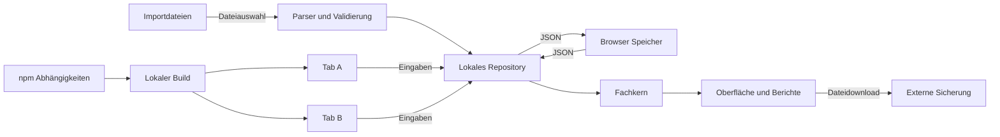

## Executive summary

Die aktuelle App ist eine lokale React-Anwendung ohne Konto, Server-API oder Cloud-Synchronisierung. Die wichtigsten belegten Risiken betreffen die Integrität und Verfügbarkeit: Ein veralteter zweiter Tab kann eine bereits gespeicherte Stunde überschreiben; ein verweigerter Zugriff auf `window.localStorage` führt zu einer leeren Oberfläche. Manipulierte Sicherungsdateien können außerdem Personen-IDs enthalten, die in der Oberfläche einen nicht gespeicherten Status vortäuschen. Eine entfernte Codeausführung oder ein nachgewiesener Datenabfluss wurde nicht festgestellt. Unbegrenztes Einlesen von JSON und das Entpacken komprimierter XLSX-Dateien bleiben konkret begründete Ressourcenrisiken.

## Scope and assumptions

- Geprüft: `app/src/`, HTML-/Vite-Einstieg, Paket-/Lockdatei, relevante Tests und lokale Produktionsvorschau. Stand: `ada6c55`, Version 0.6.1 mit den gesicherten vorhandenen CSS-Änderungen.
- Bestätigter Betrieb: eine Lehrkraft, lokaler Browser, fiktive Namen, keine Anmeldung und keine Mehrgeräte-Synchronisierung. Zwei Tabs auf demselben Ursprung sind ausdrücklich mitgeprüft.
- Dateien und Browser-Speicher sind Vertrauensgrenzen. Die App muss fremde oder beschädigte Inhalte validieren, auch wenn keine Serverübertragung erfolgt.
- Nicht geprüft: produktiver Betrieb mit echten Schülerdaten, OS-Konten, Erweiterungen, vollständige Git-Geheimnissuche, native Verpackungen, Windows, Hosting-/DNS-/Firewall-Konfiguration.
- Offene Voraussetzung: künftig unterstützte Browser und deren Speicher-/Koordinationsschnittstellen. Das beeinflusst den konkreten Rückfall für den Schreibschutz. Die Revision darf ohne weitere Angaben mit dem getesteten Chromium und ausdrücklich dokumentierten Browsergrenzen geplant werden.

Die entscheidenden Betriebsannahmen stehen bereits im Auftrag und in `docs/07-offene-entscheidungen.md` (O5). Eine weitere Kontextabfrage war für dieses lokale Modell nicht erforderlich.

## System model

### Primary components

React/Vite lädt die lokale Oberfläche (`app/index.html`, `src/main.tsx`). `App.tsx` steuert Klassen, Stunden, Dateiabläufe und Rückmeldungen. `domain/` berechnet deterministisch; `LocalRepository` liest, validiert und schreibt das Notebook. CSV/JSON/XLSX werden im Browser verarbeitet. ExcelJS wird bei Bedarf dynamisch geladen (`App.tsx:565`, `classImport.ts:82`).

### Data flows and trust boundaries

- Dateisystem zu Dateiimport: CSV/TXT/XLSX beziehungsweise JSON über `input type="file"`. Klassenlisten erhalten vor dem Lesen ein 5-MiB-Limit (`classImport.ts:78`); JSON wird ohne vorgelagerte Größenprüfung gelesen (`App.tsx:644`, `App.tsx:720`).
- Browser-Speicher zu Repository: JSON über die Storage-API. `parseNotebook` prüft Struktur und Fachinvarianten (`schema.ts:70`); Klartext, keine im Code nachgewiesene Verschlüsselung.
- Oberfläche zu Repository: Klassenänderungen verwenden teilweise den React-Snapshot (`App.tsx:288`), Beobachtungen laden den aktuellen Stand (`localRepository.ts:221`). Kein originweiter Schreibschutz und keine `storage`-Übernahme im geprüften App-Quelltext.
- Fachbericht zu Download: Blob-URLs für CSV, XLSX und JSON (`App.tsx:50`). CSV maskiert Formeleinstiege (`csvExport.ts:7`); XLSX verwendet Textwerte statt Formelobjekten. JSON bleibt die vollständige Sicherung.
- Abhängigkeitsinstallation zu Build: npm-Lockdatei und lokale Bibliotheken. Der einmalige `npm audit --json --ignore-scripts` meldete am Prüftag keine bekannten Schwachstellen. Dies beweist keine allgemeine Fehlerfreiheit.

#### Diagram

## Assets and security objectives

| Asset                                | Warum es geschützt werden muss                                                        | Ziel                      |
| ------------------------------------ | ------------------------------------------------------------------------------------- | ------------------------- |
| Beobachtungen und Stundenreihenfolge | Falsche oder verlorene Eingaben verfälschen den dokumentierten Verlauf                | Integrität, Verfügbarkeit |
| Arbeitsposition und Speicherzustand  | Lehrkraft muss erkennen, wem eine Eingabe zugeordnet ist und ob sie gespeichert wurde | Integrität, Verfügbarkeit |
| Sicherung und Rohdatenrückfall       | Eine fehlerhafte Datei oder Migration darf keinen wiederherstellbaren Stand zerstören | Integrität, Verfügbarkeit |
| Namen und Berichte                   | Aktuell fiktiv; bei einer späteren Nutzung mit echten Daten vertraulich               | Bedingte Vertraulichkeit  |
| Gebündelter Anwendungscode           | JavaScript des Ursprungs kann alle lokalen Notebook-Daten lesen                       | Integrität                |

## Attacker model

### Capabilities

Ein Dateianbieter kann JSON-/CSV-/XLSX-Inhalte gestalten. Eine Person mit demselben Browserprofil kann mehrere Tabs öffnen oder lokale Daten verändern. Erweiterungen und fremder Code auf demselben Ursprung wären im Besitz entsprechender Rechte zum Lesen des Klartexts fähig; ein solcher Zugriff wurde hier nicht als Angriff ausgeführt.

### Non-capabilities

Ein beliebiger Internetnutzer erhält durch diese App keine Server-API, kein Konto und keinen Notebook-Zugriff. Es gibt keinen Beleg für eine entfernte XSS-/RCE-Kette. OS-Zugriff und kompromittierte npm-Pakete werden als Voraussetzungen benannt, nicht als festgestellter Einbruch.

## Entry points and attack surfaces

| Oberfläche                     | Erreichbarkeit                              | Grenze / Schutz                                                                                       | Beleg                                                      |
| ------------------------------ | ------------------------------------------- | ----------------------------------------------------------------------------------------------------- | ---------------------------------------------------------- |
| Klassenliste                   | Lokale Dateiauswahl                         | 5 MiB, zwei Textspalten, 45 Personen; XLSX-Formeln abgewiesen                                         | `classImport.ts:78`, `excelWorkbook.ts:143`                |
| JSON-Import und Rettungsimport | Sicherungs-/Fehlerseite                     | Schema-/Fachprüfung und Rückfallsicherung; keine Byte-Grenze vor `.text()`                            | `App.tsx:644`, `App.tsx:720`, `localRepository.ts:346`     |
| Lokaler Speicher               | Automatisch bei Start und jeder Beobachtung | Validierung, Fehlerbehandlung im Repository; Zugriff auf das Storage-Objekt außerhalb des Start-Catch | `App.tsx:107`, `localRepository.ts:96`                     |
| Paralleler Tab                 | Derselbe Ursprung und Browserkontext        | Kein nachgewiesener Schreibschutz                                                                     | `App.tsx:288`, `localRepository.ts:139`                    |
| Datei-Downloads                | Export-/Sicherungsaktionen                  | CSV-Formelschutz; typisierte XLSX-Zellen; JSON enthält vollständigen Zustand                          | `csvExport.ts:7`, `excelWorkbook.ts:55`, `jsonBackup.ts:3` |

## Top abuse paths

1. Zwei Tabs laden denselben Stand. B speichert eine neue Stunde. A wählt eine Klasse und schreibt den veralteten Gesamtzustand. Die Stunde verschwindet. **Reproduziert.**
2. Eine Sicherungsdatei verwendet die Personen-ID `toString`. Der Validator akzeptiert sie. Direkte Objektzugriffe liefern eine geerbte Funktion als scheinbare Beobachtung. Die Oberfläche zeigt „Nicht beobachtet“ statt „Offen“. **Reproduziert; kein Nachweis einer Prototype-Pollution oder Codeausführung.**
3. Eine sehr große JSON-Datei wird ausgewählt oder eine kleine XLSX-Datei entpackt sich zu großem Inhalt. Einlesen und Parsing beanspruchen den Hauptthread vor allen fachlichen Grenzen. **Quellcodebeleg für die fehlende JSON-Grenze; kein gezielter Speichererschöpfungsangriff ausgeführt.**
4. Eine Browserrichtlinie verweigert den Zugriff auf `localStorage`. Die Initialisierung wirft vor der Fehlerbehandlung. Die Lehrkraft sieht eine leere Seite. **Mit simulierter SecurityError-Ausnahme reproduziert.**
5. Eine JSON-Sicherung wird versehentlich an unberechtigte Personen weitergegeben oder fremder Code besitzt Zugriff auf denselben Browser-Ursprung. Der Klartext ist lesbar. **Formateigenschaft und bedingtes Betriebsrisiko; kein beobachteter Datenabfluss.**

## Threat model table

| ID     | Quelle / Voraussetzung                                                                        | Aktion und Auswirkung                                              | Asset                  | Vorhandene Kontrolle                                                                          | Lücke                                                          | Maßnahme / Erkennung                                                                                                                                           | Wahrscheinlichkeit | Auswirkung                                                         | Priorität |
| ------ | --------------------------------------------------------------------------------------------- | ------------------------------------------------------------------ | ---------------------- | --------------------------------------------------------------------------------------------- | -------------------------------------------------------------- | -------------------------------------------------------------------------------------------------------------------------------------------------------------- | ------------------ | ------------------------------------------------------------------ | --------- |
| TM-001 | Zweiter Tab, gewöhnliche lokale Nutzung                                                       | Veraltetes Gesamtdokument überschreibt neue Stunden                | Beobachtungen          | Beobachtungen laden vor dem Schreiben neu                                                     | Klassenaktionen nutzen alte Snapshots                          | Einen Schreibberechtigten koordinieren; Zweit-Tab anzeigen; reproduzierte Zwei-Tab-Regression                                                                  | medium             | high                                                               | high      |
| TM-002 | Manipulierte JSON-Datei mit reservierter ID                                                   | Fehlende Beobachtung wird als NB angezeigt                         | Korrekte Statusanzeige | Schema prüft IDs auf nicht leeren Text                                                        | Direkter Zugriff auf geerbte Eigenschaften                     | Eigene Schlüssel explizit prüfen; solche Dateien verlustfrei behandeln oder mit klarer Meldung ablehnen; gezielte Fixture                                      | low                | medium                                                             | medium    |
| TM-003 | Große JSON-/komprimierte XLSX-Datei                                                           | Speicher-/Rechenlast kann die lokale Bedienung blockieren          | Verfügbarkeit          | Klassenlisten: 5 MiB und 45 Personen                                                          | JSON ohne Vorablimit; XLSX-Prüfung erst nach Entpackung        | Byte-Limit vor Lesen, verständliche Ablehnung, Ressourcenprüfung für ZIP; Grenztests statt unbeschränkter Angriffsdatei                                        | low                | medium                                                             | medium    |
| TM-004 | Browser verweigert Storage-Zugriff                                                            | Leere Startseite verhindert Wiederaufnahme und verständliche Hilfe | Verfügbarkeit          | Repository fängt Lese-/Schreibfehler                                                          | Zugriff auf Storage außerhalb von `loadResult`-Catch           | Geschützte Initialisierung; Recovery-/Hinweisansicht; Fault-Injection als Regression                                                                           | low                | medium                                                             | medium    |
| TM-005 | Zugriff auf Browserprofil, heruntergeladene Sicherung oder kompromittierten gleichen Ursprung | Klartext kann gelesen oder verändert werden                        | Namen und Notebook     | Keine Konto-/Cloud-/externen Laufzeitaufrufe im App-Code; React-Textausgabe; CSV-/XLSX-Schutz | Lokale Ablage ist keine Verschlüsselung oder Zugriffskontrolle | Herkunft und Schutz der Sicherung erklären; fiktive Daten beibehalten; echten Betrieb separat freigeben; keine neue Cloud/Authentifizierung in dieser Revision | low                | low im bestätigten fiktiven Einsatz, high bedingt bei echten Daten | low       |

## Criticality calibration

**critical** wäre hier eine belegte entfernte Codeausführung oder ein von außen ausgelöster vollständiger Datenabfluss. Beides wurde nicht festgestellt. **high** bezeichnet bereits reproduzierbaren Verlust erfolgreich gespeicherter Eingaben, wie TM-001. **medium** bezeichnet falsche Statusdarstellung aus einer manipulierten Datei oder eine ausfallende lokale Oberfläche mit konkreter Voraussetzung. **low** bezeichnet zusätzliche Absicherung wie verständlichere Sicherungshinweise im bestätigten fiktiven Einzelplatzbetrieb. Die Einordnung ist kein Nachweis für die Zulässigkeit einer späteren Nutzung mit echten Schülerdaten.

## Focus paths for security review

| Pfad                                                                        | Schwerpunkt                                                              | IDs                    |
| --------------------------------------------------------------------------- | ------------------------------------------------------------------------ | ---------------------- |
| `app/src/App.tsx`                                                           | Storage-Initialisierung, veraltete Klassenaktionen, beide JSON-Einstiege | TM-001, TM-003, TM-004 |
| `app/src/infrastructure/local/localRepository.ts`                           | Alle Schreibwege, Sicherungsreihenfolge und Rückfall                     | TM-001, TM-003         |
| `app/src/infrastructure/local/schema.ts`                                    | Untrusted IDs und Strukturgrenzen                                        | TM-002, TM-003         |
| `app/src/features/presentation.ts`                                          | Statusausgabe aus möglicherweise geerbten Eigenschaften                  | TM-002                 |
| `app/src/infrastructure/importExport/classImport.ts` und `excelWorkbook.ts` | Datei-/Entpackungsgrenzen; typisierte Textwerte                          | TM-003, TM-005         |
| `app/src/infrastructure/importExport/csvExport.ts` und `jsonBackup.ts`      | Formelschutz versus Vollsicherung                                        | TM-005                 |

## Notes on use

Alle entdeckten Datei-, Speicher-, Tab- und Downloadgrenzen sind enthalten. Laufzeit, Build und historische Referenzen wurden getrennt betrachtet. Annahmen stammen aus dem Auftrag; verbleibende Browser-/Betriebsfragen sind markiert. Belege: [Browserprüfung](nachweise/browserergebnisse.json), [Ergänzungen](nachweise/ergaenzende-ergebnisse.json), [Fehlerfälle](nachweise/fehlerfaelle.json), [npm-Audit](nachweise/npm-audit.json). Keine DNS-/Firewall-/Hostingänderung und kein Datenversand an Korrektur- oder Prüfservices.
